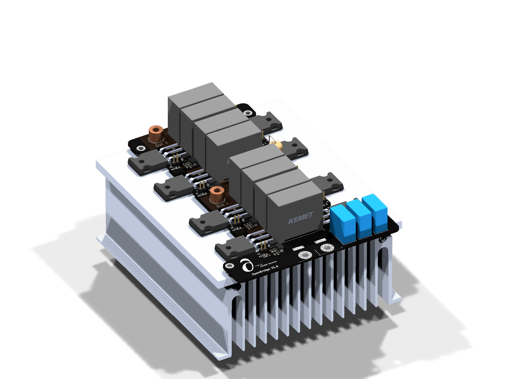
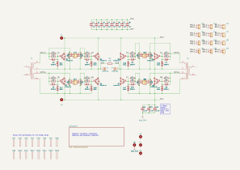
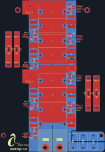

# OpenBridge

An open-source eight-IGBT full-bridge power stage for DRSSTC/Tesla-coil builds, designed in KiCad 10. It uses an external gate driver and DC supply, with two off-board gate-drive transformers and a Wakefield 511-6M heatsink.



| Schematic | PCB layout |
| :---: | :---: |
| [](docs/images/schematic.svg) | [](docs/images/pcb.svg) |

The 3D preview shows the main board after removing the four breakaway GDT strips. The PCB layout shows the complete fabrication board, with blue bottom copper beneath red top copper. Click either drawing for the full-size view.

## Project files

Open **[OpenBridge.kicad_pro](OpenBridge.kicad_pro)** in KiCad 10 or newer with the standard symbol, footprint and 3D-model libraries installed. Custom parts and STEP models are included in `OpenBridge.pretty`, `OpenBridge.kicad_sym` and `OpenBridge.3dshapes`.

The [Hardware subsheet](Hardware.kicad_sch) collects the heatsink, IGBT insulators, shoulder washers, spacers, cable connectors and assembly hardware. See its [drawing](docs/images/hardware.svg), the [BOM for one board](docs/bom.csv), and [assembly/BOM notes](docs/assembly.md).

GDT winding details, wire sizes, fastener lengths and other coil-dependent choices are **unspecified**. The BOM includes generic assembly materials; it does not define a complete coil, gate driver, power supply, fan or enclosure. Component ratings are not a validated operating rating for the assembled bridge.

## Update the previews

With Python 3.10+ and KiCad 10+ installed, run from the repository:

```sh
python scripts/update_previews.py
```

This audits the BOM and regenerates all README images from the saved design. Add `--watch` to refresh after saves while editing. The script uses a temporary board copy and isolated rendering settings, so it does not modify the manufacturing PCB or your KiCad preferences.

Set `board_color` in **[scripts/render-config.json](scripts/render-config.json)** to change the 3D solder mask. It defaults to `Black`; named KiCad colors and `#RRGGBB` are supported. The same file controls camera angle, image size and breakaway-strip removal. Run the script again after changing it.

KiCad is found automatically on Windows or through `PATH`. Set `KICAD_CLI` if needed, and `KICAD10_3DMODEL_DIR` if the standard models are installed elsewhere. Run `python scripts/check_bom.py` for the BOM audit/export alone.

The included [GitHub workflow](.github/workflows/previews.yml) refreshes and commits images/BOM after design changes are pushed to `main`, using the [official KiCad container](https://www.kicad.org/download/docker/). It needs Actions enabled and permission to push generated files; with branch protection, regenerate locally and include them in your normal review. The checked-in images also work offline.

## Contributing and license

Keep the schematic as the source of truth for parts, update the PCB from it when needed, and regenerate previews/BOM with design changes. Run KiCad ERC and DRC before proposing a change. Existing findings are recorded in the [assembly notes](docs/assembly.md); the project is not represented as having a clean release check.

See [LICENSE](LICENSE) for the repository's GPL-3.0 license. Third-party libraries, datasheets and manufacturer models retain their applicable terms.
